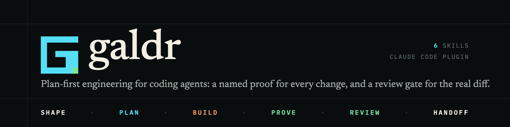

<p align="center">
  
</p>

<p align="center">
  
  <a href="CHANGELOG.md"></a>
  <a href="skills/"></a>
  
  
</p>

<h1 align="center">galdr</h1>

<p align="center">
  <b>Six small skills that make an AI coding agent work like a careful engineer:<br>
  a plan and a named proof before code, fresh evidence before "done",<br>
  a review at each logical unit, and your approval of the real diff when you ask.</b>
</p>

<p align="center">
  <a href="#the-flow">Flow</a> ·
  <a href="#the-skills">Skills</a> ·
  <a href="#the-review-gate">Review gate</a> ·
  <a href="#install">Install</a> ·
  <a href="#use">Use</a> ·
  <a href="#how-it-was-tested">Tested</a>
</p>

<p align="center">
  <i>galdr</i>: Old Norse for "incantation." A plugin for Claude Code. The skills also
  install into other agents as plain <code>SKILL.md</code> files.
</p>

---

## Who is this for

You use an AI agent to write code, and one of these statements is true:

- It writes code without tests, and the bugs that it "fixed" come back.
- It says "done", and you cannot tell if it ran anything.
- It builds more than you asked for, or it asks ten questions before it starts.
- You want to approve the actual change, not the agent's summary of it.

galdr costs nothing until you use it. It has no always-on hook. Two discipline skills
load when they apply. The other skills wait for a slash command.

## The flow


`/galdr` reads the request and picks one playbook:

| Request | Playbook | Ends with |
|---|---|---|
| A question or a critique | `investigate` | A cited answer and one recommendation. Nothing is edited |
| New or changed behavior | `feature` | A plan file, tasks with proofs, a closeout for each unit |
| Behavior that is wrong | `bug` | The root cause, a failing test, the fix |
| Structure or performance pain | `refactor` | One ranked finding fixed, with the tests unchanged |
| A design question that code can answer | `prototype` | A recorded decision and a test list. The prototype is deleted |

A clear routine change needs no plan file. Other work keeps one local plan file in
`docs/plans/`: the goal and decisions, the design, the tasks, the evidence lines and a
`next:` line. A new session continues from `next:`.

After each logical unit, galdr closes it out. It decides how deep to review, and if the
change needs an independent reviewer. It decides from the defect that the change can
cause, and it states the decision in one line. Then it commits the unit.

When you correct galdr, it proposes a check that stops the mistake next time: a better
API or structure, a lint rule, a type or a test, and a line in `CLAUDE.md` only when no
check can find it. It counts the existing occurrences and adds the check when you
approve. It does not build new code on a workaround that it finds in the code, and for a change you
can see, its proof includes a screenshot, a recording or the output.

## The skills

| Skill | Loads | What it does |
|---|---|---|
| [`galdr`](skills/galdr/SKILL.md) | `/galdr` | Picks the playbook, keeps the plan, does the tasks, closes out each unit, finishes |
| [`shape`](skills/shape/SKILL.md) | `/galdr:shape` | Turns an idea into the goal and decisions of the plan. Finds facts itself and asks at most 3 questions |
| [`prove`](skills/prove/SKILL.md) | on its own | A named proof for each change, test-first for bugs, checks from CI, fresh evidence before "done" |
| [`debug`](skills/debug/SKILL.md) | on its own | No fix without a root cause. Stops a live incident first |
| [`review`](skills/review/SKILL.md) | `/galdr:review` | Spec and quality verdicts, comments-are-guilty, the installed language skill, the browser gate |
| [`handoff`](skills/handoff/SKILL.md) | `/galdr:handoff` | A brief that a new session can use, and the report that comes back |

All skill text follows ASD-STE100 Simplified Technical English: one instruction in each
sentence, active voice, simple tenses, one meaning for each word.

## The review gate

[`/galdr:review`](skills/review/SKILL.md) checks a change against its plan first and
against code quality second. It gives two separate verdicts. When you ask for it, it
opens a local page. The page shows the real working-tree diff, not a description of it,
and waits for your decision:

- **approve** records an approval for that exact state.
- **request changes** sends your line comments back to the agent.
- An edit after the approval cancels it. Then the gate's verify step fails at commit
  time until you look again.

For an independent review, galdr uses its own `reviewer` agent. It has no Edit or Write
tool. It still has Bash, and only its instructions forbid writes through the shell.

It runs on Python 3.9 or newer with no installs. The fonts and scripts are bundled, and
the page loads nothing from the network.

## Install

### Claude Code

```
/plugin marketplace add nyelonong/galdr
/plugin install galdr@nyelonong
```

### Other agents

```
npx skills add nyelonong/galdr
```

The skills are plain `SKILL.md` files. The review gate is inside `skills/review/`, so it
works wherever the skill goes.

### Upgrading from 1.x

2.0 is a breaking release. `tdd` and `verify` became one skill, `prove`. galdr now closes
out and commits each logical unit itself. The [CHANGELOG](CHANGELOG.md) maps each old
command to its replacement.

## Use

- Start work with `/galdr <request>`.
- galdr finds the checks in your CI configuration first, then in your scripts, then in
  your `CLAUDE.md` or `AGENTS.md`. It has no configuration file of its own.
- galdr never pushes, merges, deploys or publishes without your go for that action.
  When you give the go, it finishes the action. It does not give the last step back.

## How it was tested

Each skill was tested before release, with and without its text loaded:

- **Discipline skills under pressure.** The `prove` and `debug` scenarios pass with the
  skill loaded, with zero forbidden behaviors.
- **Retrieval checks.** `galdr` routes requests to the right playbook and makes its own
  review decisions. `shape`, `review` and `handoff` pass their probes.
- **Voice.** Each skill file passes the ASD-STE100 linter with zero hard findings.
- **The gate.** 230 Python and 28 JavaScript tests, on Python 3.9 and 3.13.

## Acknowledgments

galdr builds on ideas from [obra/superpowers](https://github.com/obra/superpowers) (MIT)
and [mattpocock/skills](https://github.com/mattpocock/skills) (MIT). It is an
independent implementation. The STE linter in its tests comes from
[danyuchn/asd-ste100-skill](https://github.com/danyuchn/asd-ste100-skill) (MIT).
